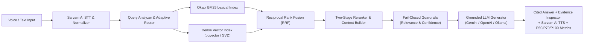

# SAMVAD | संवाद

> **Intelligence Through Evidence — Voice-First, Evidence-Grounded Multilingual RAG Platform**

[](https://www.python.org/)
[](https://fastapi.tiangolo.com/)
[](https://nextjs.org/)
[](https://www.typescriptlang.org/)
[](https://www.postgresql.org/)

**SAMVAD (संवाद)** is a full-stack, voice-first Retrieval-Augmented Generation (RAG) platform engineered for multilingual and Indic-language research workflows. It combines hybrid Reciprocal Rank Fusion (BM25 + dense vector search), two-stage reranking, fail-closed hallucination guardrails, multi-tenant cloud persistence, and real-time pipeline observability into a unified research workspace.

---

## Key Capabilities

- **Hybrid Retrieval & Two-Stage Ranking**  
  Combines Okapi BM25 lexical search with dense vector cosine retrieval (`pgvector` / local TF-IDF SVD 128d / OpenAI-compatible embeddings) via **Reciprocal Rank Fusion (RRF)**, adaptive query routing, retrieval caching, and cross-stage reranking.
- **Voice-First Multilingual & Indic Interaction**  
  Supports native Indic speech-to-text and text-to-speech powered by **Sarvam AI** (`saaras:v3` STT & `bulbul` TTS), with pluggable ElevenLabs and Gemini STT adapters, speech transcript normalization, and Unicode NFC normalization.
- **Fail-Closed Grounding & Citation Guardrails**  
  Enforces strict inline source citations (`[1]`, `[2]`), input validation, relevance overlap checks, and confidence thresholds. Automatically triggers **honest abstention** when retrieved evidence is insufficient—eliminating unsupported hallucinations.
- **Multi-Tenant Document Isolation & Ingestion**  
  Ingests `PDF`, `DOCX`, `Markdown`, `TXT`, `HTML`, and `JSON` documents with SHA-256 deduplication and configurable chunking strategies (`sliding_window`, `semantic`, `whole_passage`). Backed by **Supabase PostgreSQL (`pgvector`)** with **Row-Level Security (RLS)** and per-user isolation, plus a local SQLite fallback for offline development.
- **Interactive Research Workspace & Live Observability**  
  Next.js workspace featuring persistent Knowledge Base state, clickable inline citations, an interactive **Evidence & Pipeline Inspector**, Server-Sent Events (SSE) stage streaming, session management, and real-time **P50 / P70 / P100** latency telemetry.
- **Automated Evaluation & Security Test Suite**  
  Includes a built-in evaluation harness (`backend/app/evaluation/`) and **32 pytest suites** covering end-to-end orchestration, hybrid RRF, reranking, guardrails, multi-tenant document APIs, and security red-teaming.

---

## System Architecture



---

## Tech Stack

| Layer | Technologies |
| :--- | :--- |
| **Frontend** | Next.js (App Router), React, TypeScript, Tailwind CSS |
| **Backend API** | FastAPI, Pydantic v2, Uvicorn, SSE Streaming, Custom Middleware |
| **Retrieval & Ranking** | Okapi BM25, TF-IDF SVD (128d) / OpenAI-Compatible Embeddings, Reciprocal Rank Fusion (RRF), Reranker |
| **LLM & Speech** | Google Gemini, OpenAI, Ollama (pluggable) · Sarvam AI (`saaras:v3` STT / `bulbul` TTS), ElevenLabs |
| **Database & Security** | Supabase PostgreSQL (`pgvector`, Pooled Connections, Row-Level Security), SQLite fallback, Per-User Tenant Scoping |
| **Observability & QA** | Structured Request-ID Logging, P50/P70/P100 Telemetry Store, Evaluation Harness, Pytest (32 test modules) |

---

## Project Structure

```text
samvad-rag/
├── frontend/                              # Next.js Research Workspace
│   ├── app/
│   │   ├── page.tsx                       # Main research workspace & chat canvas
│   │   ├── documents/page.tsx             # Knowledge Base registry & multi-format uploader
│   │   ├── architecture/page.tsx          # Interactive Pipeline Explorer
│   │   ├── analytics/page.tsx             # P50/P70/P100 latency & stage analytics
│   │   └── settings/page.tsx              # Workspace & pipeline preferences
│   ├── components/
│   │   ├── workspace/                     # QueryComposer, ResearchMessage, EvidenceInspector
│   │   ├── layout/                        # AppShell, UserAccountMenu, ThemeProvider
│   │   ├── auth/                          # Authentication modal & flows
│   │   ├── voice/                         # Browser microphone recorder & playback
│   │   └── analytics/                     # Latency percentile visualizations
│   ├── context/                           # AuthContext, persistent KnowledgeBaseContext
│   ├── hooks/                             # Voice recording & client hooks
│   └── lib/api/client.ts                  # Typed API client with tenant & auth headers
│
├── backend/                               # FastAPI RAG Orchestration Engine
│   ├── app/
│   │   ├── main.py                        # App factory, CORS, rate limiting, API middleware
│   │   ├── api/                           # Query, Voice, Documents, Auth, Analytics, Health routes
│   │   ├── pipeline/                      # State machine, orchestrator, runtime index manager
│   │   ├── ingestion/                     # Multi-format loaders, Unicode normalizer, chunker, store
│   │   ├── retrieval/                     # BM25, dense, hybrid RRF, router, reranker, cache, compressor
│   │   ├── embeddings/                    # Local TF-IDF SVD & OpenAI-compatible providers
│   │   ├── generation/                    # Citation-enforced LLM generator (Gemini / OpenAI / Ollama)
│   │   ├── speech/                        # Sarvam AI / ElevenLabs STT, TTS, transcript normalizer
│   │   ├── guardrails/                    # Input, relevance, confidence & fail-closed guards
│   │   ├── db/                            # Pooled PostgreSQL/SQLite manager, schema & RLS migrations
│   │   ├── analytics/                     # Bounded telemetry store & percentile calculators
│   │   └── evaluation/                    # Automated benchmark runner, loader, metrics & CLI
│   ├── tests/                             # 32 pytest suites (E2E, retrieval, security, API, eval)
│   ├── Dockerfile
│   └── requirements.txt
│
├── docs/                                  # Technical Specifications & ADRs
│   ├── architecture.md                    # Detailed system architecture
│   ├── DECISIONS.md                       # Architectural Decision Records
│   ├── EVALUATION_STRATEGY.md             # Evaluation metrics & reproducibility guidelines
│   ├── ROADMAP.md                         # Engineering roadmap
│   └── KNOWN_LIMITATIONS.md               # Current constraints & trade-offs
│
├── .github/workflows/ci.yml               # Continuous Integration workflow
├── docker-compose.yml                     # Containerized deployment setup
└── README.md
```

---

## Quick Start

### Prerequisites

- **Python** 3.11+ (3.12 recommended)
- **Node.js** 18+ (20 LTS recommended) and `npm`
- **PostgreSQL / Supabase** (optional — falls back cleanly to local SQLite if `DATABASE_URL` is omitted)

### 1. Configure Environment Variables

Create `backend/.env` (using `.env.example` as a template):

| Variable | Description | Required |
| :--- | :--- | :--- |
| `DATABASE_URL` | PostgreSQL / Supabase connection URI (`sslmode=require`) | Optional (SQLite fallback) |
| `LLM_PROVIDER` | Active LLM backend: `gemini`, `openai`, or `ollama` | For generation |
| `LLM_MODEL` | Model identifier (e.g., `gemini-2.5-flash`, `gpt-4o-mini`) | For generation |
| `LLM_API_KEY` | Provider API key | For cloud LLMs |
| `STT_PROVIDER` | Speech provider: `sarvam`, `elevenlabs`, or `gemini` | For voice features |
| `SARVAM_API_KEY` | Sarvam AI API key for Indic STT (`saaras:v3`) & TTS (`bulbul`) | For Sarvam voice |
| `EMBEDDING_PROVIDER` | `local_tfidf_svd` (offline default) or `openai_compatible` | No |
| `CORS_ORIGINS` | Comma-separated allowed frontend origins | No (`http://localhost:3000`) |

### 2. Run the Backend

```bash
cd backend

# Create and activate virtual environment
python -m venv .venv
# Windows:
.venv\Scripts\activate
# macOS / Linux:
# source .venv/bin/activate

# Install dependencies
pip install -r requirements.txt

# Start FastAPI server
uvicorn app.main:app --host 127.0.0.1 --port 8000 --reload
```

- API Base URL: `http://127.0.0.1:8000`
- Interactive Swagger Docs: `http://127.0.0.1:8000/docs`

### 3. Run the Frontend

```bash
cd frontend
npm install
npm run dev
```

- Research Workspace UI: `http://localhost:3000`

---

## API Reference

| Method | Endpoint | Description |
| :--- | :--- | :--- |
| `GET` | `/health` | Service health & connectivity check |
| `GET` | `/api/v1/pipeline/status` | Live index counts, active LLM/STT providers & retrieval readiness |
| `POST` | `/api/v1/query` | Execute text query with hybrid/dense/BM25 retrieval, reranking & citations |
| `POST` | `/api/v1/query/stream` | Real-time stage-by-stage SSE streaming query execution |
| `POST` | `/api/v1/voice/query` | Upload audio for multilingual STT transcription + grounded RAG response |
| `POST` | `/api/v1/voice/speak` | Synthesize Indic/multilingual spoken response via Sarvam AI TTS |
| `POST` | `/api/v1/documents` | Ingest, normalize, deduplicate & index multi-format documents (tenant-scoped) |
| `GET` | `/api/v1/documents` | List authenticated user's indexed documents and metadata |
| `GET` | `/api/v1/documents/{doc_id}/chunks` | Inspect chunked passages for a specific document |
| `DELETE` | `/api/v1/documents/{doc_id}` | Delete a document and its indexed chunks (enforces tenant ownership) |
| `GET` | `/api/v1/analytics/summary` | Aggregate query volume, grounding rate, and stage performance |
| `GET` | `/api/v1/analytics/latency` | P50 / P70 / P100 end-to-end and per-stage latency benchmarks |
| `POST` | `/api/v1/auth/signup` · `/login` | User registration, session login, and profile management |

---

## Testing & Evaluation

Run the full backend test suite (32 test modules covering retrieval, reranking, guardrails, streaming, security red-teaming, and E2E orchestration):

```bash
cd backend
pytest -v
```

Run the automated retrieval & grounding evaluation CLI:

```bash
cd backend
python -m app.evaluation.cli --help
```

---

## Documentation

- [System Architecture](docs/architecture.md)
- [Architectural Decision Records (ADRs)](docs/DECISIONS.md)
- [Evaluation Strategy](docs/EVALUATION_STRATEGY.md)
- [Engineering Roadmap](docs/ROADMAP.md)
- [Known Limitations](docs/KNOWN_LIMITATIONS.md)

---

## License

This project is released under the MIT License. See the repository for details.
