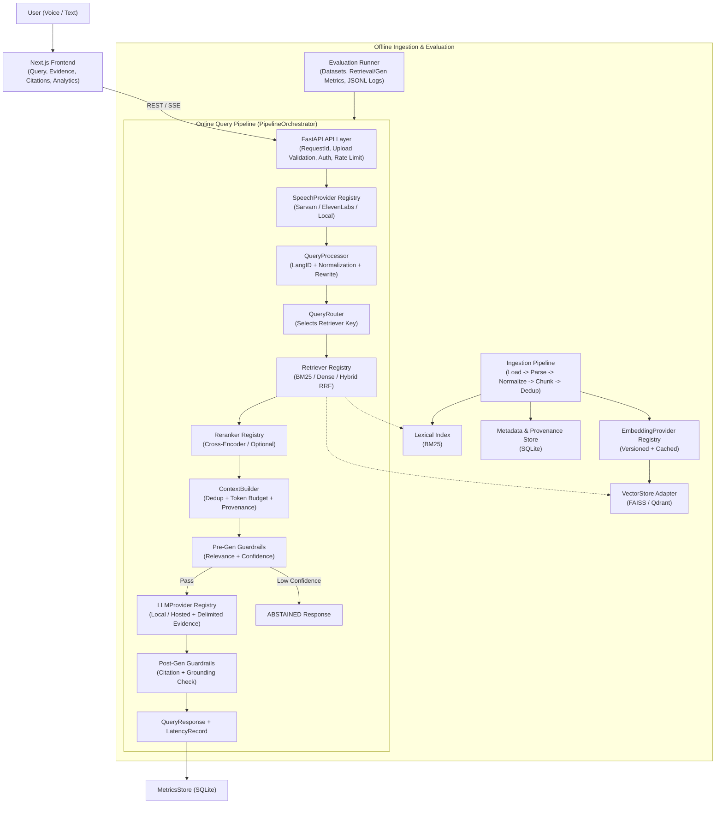

# SAMVAD-RAG — Implemented & Target Architecture

> **Documentation Rule:** This document clearly separates **what is currently implemented** from **what is scaffolded/planned**. Nothing in the "Target" sections should be assumed functional until marked implemented.

---

## 1. Current Implemented Architecture (Actual State — Phase 2 Complete)

SAMVAD-RAG runs as a modular FastAPI + SQLite + Next.js monolith with working ingestion, hybrid retrieval, optional LLM generation, and live telemetry.

```text
[Next.js 16 Editorial Research Workbench]
  ├── /               (3-Zone Workspace: Sidebar + Thread/Citations + Composer + Evidence/Pipeline Inspector)
  ├── /documents      (Drag-and-drop Knowledge Base Manager + Chunking Config + Delete Confirmation)
  ├── /architecture   (Live Subsystem Capability Audit via GET /api/v1/pipeline/status)
  ├── /analytics      (Live P50/P70/P100 Latency Telemetry via GET /api/v1/analytics/*)
  └── /settings       (Theme, Default Retriever, Live Backend Status & .env Provider Setup)
          │
          │ HTTP JSON / Multipart (CORS: GET, POST, DELETE, OPTIONS)
          ▼
[FastAPI Backend — backend/app/main.py & pipeline/runtime.py]
  ├── GET    /health                    ──▶ App name, version, environment
  ├── GET    /api/v1/pipeline/status    ──▶ Live retrieval/embedding/LLM/reranker/STT readiness
  ├── POST   /api/v1/documents          ──▶ Load -> Normalize -> SHA-256 Dedup -> Chunk -> SQLite + Reindex
  ├── GET    /api/v1/documents          ──▶ List registered/indexed documents & chunk counts
  ├── DELETE /api/v1/documents/{doc_id} ──▶ Cascade delete + rebuild Lexical & Dense indexes
  ├── POST   /api/v1/query              ──▶ PipelineOrchestrator.run_text_query() (Hybrid/Dense/Lexical + LLM)
  ├── POST   /api/v1/voice/query        ──▶ Validated audio upload -> STT not_implemented (Phase 4)
  ├── GET    /api/v1/analytics/summary  ──▶ Live MetricsStore summary
  └── GET    /api/v1/analytics/latency  ──▶ Per-stage P50/P70/P100 latency stats
```

### Currently Implemented Modules
- **API & App Factory:** `backend/app/main.py`, `backend/app/api/routes_{health,query,voice,analytics,documents}.py`
- **Core Infrastructure:** `backend/app/core/{config,errors,logging,upload_validation}.py`
- **Ingestion & Provenance:** `backend/app/ingestion/{normalizer,loaders,chunker,store}.py` (TXT/MD/PDF/DOCX/HTML/JSON, NFC normalization, Indic sentence splitting, SQLite `DocumentStore`)
- **Embeddings & Retrieval:** `backend/app/embeddings/{interfaces,providers}.py` (`LocalTfidfSVDProvider`, `OpenAICompatibleEmbeddingProvider`), `backend/app/retrieval/{lexical,dense,hybrid}.py` (Unicode BM25, L2 cosine `.npz` Dense, weighted RRF Hybrid)
- **Generation:** `backend/app/generation/generator.py` (`OpenAICompatibleGenerator`, `GeminiGenerator`, delimited `<evidence>` packaging, `[n]` citation extraction)
- **Pipeline State Machine & Runtime:** `backend/app/pipeline/{state,orchestrator,runtime}.py`
- **Analytics & Evaluation Harness:** `backend/app/analytics/{percentiles,metrics}.py`, `backend/app/evaluation/{schemas,loader,metrics,runner,cli}.py`

### Currently Scaffolded / Planned Modules (Phases 3–4)
- `backend/app/retrieval/reranker.py` — `CrossEncoderReranker` raises `RetrievalError` (Phase 3)
- `backend/app/guardrails/interfaces.py` — `RelevanceGuard`, `ConfidenceGuard`, `GroundingGuard` raise `NotImplementedError` (Phase 3; `InputGuard` is active)
- `backend/app/speech/` — `SarvamSpeechProvider` and `ElevenLabsSpeechProvider` raise `SpeechProcessingError` (Phase 4)

---

## 2. Target Modular Monolith Architecture (Phases 1–5)



### Canonical Internal Data Flow Principles
1. **Single Canonical Interface Layer:** `backend/app/pipeline/interfaces.py` defines the authoritative service `Protocol`s and `ScoredChunk` data container, eliminating duplicate `ABC` hierarchies.
2. **Registry-Driven Orchestration:** `PipelineOrchestrator` receives a `dict[str, Retriever]` registry alongside single/fallback providers for STT, reranking, generation, and guardrails, enforcing `stage_timeout_seconds`, `pipeline_timeout_seconds`, and bounded retries.
3. **Score Separation:** `ScoredChunk` explicitly separates `retrieval_score`, `reranker_score`, and `retrieval_method` so scores from incompatible scales (e.g., BM25 vs cosine vs cross-encoder logits) are never conflated.
