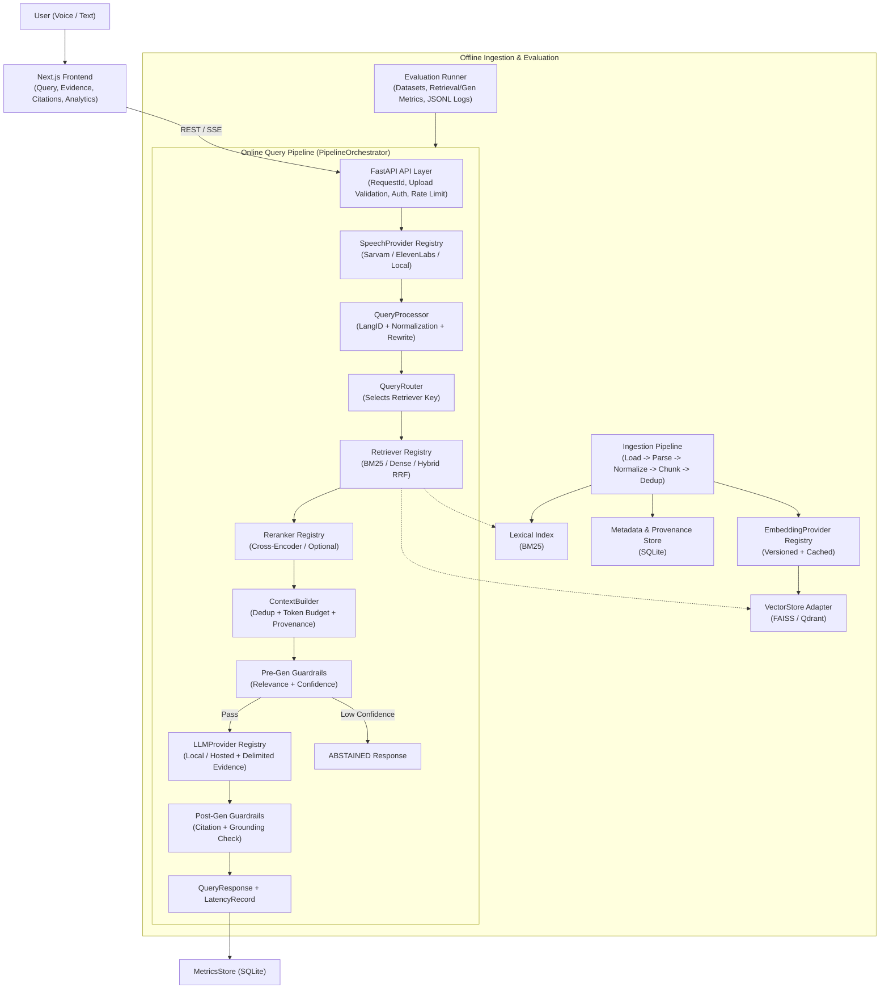

# SAMVAD-RAG — Implemented & Target Architecture

> **Documentation Rule:** This document clearly separates **what is currently implemented** from **what is scaffolded/planned**. Nothing in the "Target" sections should be assumed functional until marked implemented.

---

## 1. Current Implemented Architecture (Actual State)

SAMVAD-RAG is currently a **modular monolith skeleton** consisting of a FastAPI backend and a Next.js frontend.

```text
[Next.js 16 Frontend]
  ├── /               (VoiceButton + TextQueryInput + AnswerPanel + static PipelineVisualizer)
  ├── /analytics      (Polls GET /api/v1/analytics/latency)
  └── /architecture   (Static design overview)
          │
          │ HTTP JSON / Multipart (CORS)
          ▼
[FastAPI Backend — backend/app/main.py]
  ├── GET  /health                    ──▶ Returns app name, version, environment
  ├── GET  /api/v1/analytics/summary  ──▶ In-memory MetricsStore (empty)
  ├── GET  /api/v1/analytics/latency  ──▶ In-memory MetricsStore + percentile math
  ├── POST /api/v1/query              ──▶ PipelineOrchestrator.run_text_query() ──▶ status: "not_implemented"
  └── POST /api/v1/voice/query        ──▶ PipelineOrchestrator.run_voice_query() ──▶ status: "not_implemented"
```

### Currently Implemented Modules
- **API & App Factory:** `backend/app/main.py`, `backend/app/api/routes_*.py`
- **Core Infrastructure:** `backend/app/core/config.py` (`pydantic-settings`), `errors.py` (`SamvadError` hierarchy + JSON envelope handlers), `logging.py` (structured format + `current_request_id` `ContextVar`)
- **Contracts & Schemas:** `backend/app/schemas/{request,response,pipeline,analytics}.py`
- **Pipeline State Machine:** `backend/app/pipeline/state.py` (`PipelineState`, `VALID_TRANSITIONS` — implemented and unit-tested, not yet wired into `PipelineOrchestrator`)
- **Analytics Math & Store:** `backend/app/analytics/percentiles.py` (`compute_percentile`, `compute_stats`) and `metrics.py` (thread-safe bounded in-memory `MetricsStore`)
- **Evaluation Harness (Phase 1):** `backend/app/evaluation/{schemas,metrics,runner}.py` (dataset integrity validation, deterministic IR metrics, immutable experiment logging — tested with mock retrievers)
- **Frontend UI & Mic Capture:** `frontend/hooks/use-voice-recorder.ts` (`MediaRecorder` WebM/Opus capture) and `frontend/lib/api/client.ts`

### Currently Scaffolded / Unimplemented Modules
- `backend/app/speech/` — `SarvamSpeechProvider` and `ElevenLabsSpeechProvider` raise `SpeechProcessingError`
- `backend/app/retrieval/` — `DenseRetriever`, `LexicalRetriever`, `HybridRetriever`, `CrossEncoderReranker` raise `RetrievalError`; `AdaptiveRouter` returns `"hybrid"`
- `backend/app/generation/` — `LLMGenerator` raises `GenerationError`
- `backend/app/guardrails/` — `RelevanceGuard`, `ConfidenceGuard`, `GroundingGuard` (placeholder stubs being updated in Phase 0 so they do not silently pass)
- `backend/ingestion/` & `backend/benchmarks/` — documentation only, no executable code
- `embeddings/`, `storage/`, `evaluation/` — not yet created

---

## 2. Target Modular Monolith Architecture (Phases 1–5)



### Canonical Internal Data Flow Principles
1. **Single Canonical Interface Layer:** `backend/app/pipeline/interfaces.py` defines the authoritative service `Protocol`s and `ScoredChunk` data container, eliminating duplicate `ABC` hierarchies.
2. **Registry-Driven Orchestration:** `PipelineOrchestrator` receives a `dict[str, Retriever]` registry alongside single/fallback providers for STT, reranking, generation, and guardrails, enforcing `stage_timeout_seconds`, `pipeline_timeout_seconds`, and bounded retries.
3. **Score Separation:** `ScoredChunk` explicitly separates `retrieval_score`, `reranker_score`, and `retrieval_method` so scores from incompatible scales (e.g., BM25 vs cosine vs cross-encoder logits) are never conflated.
